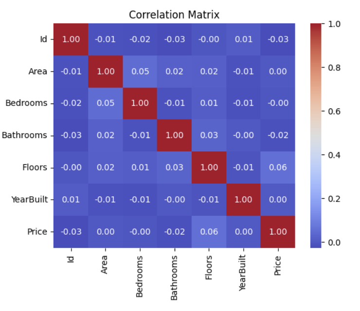
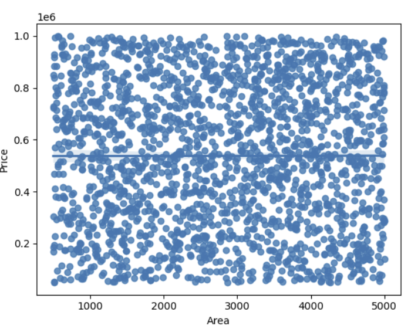
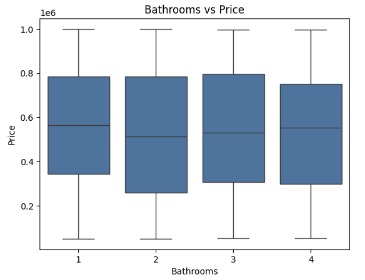
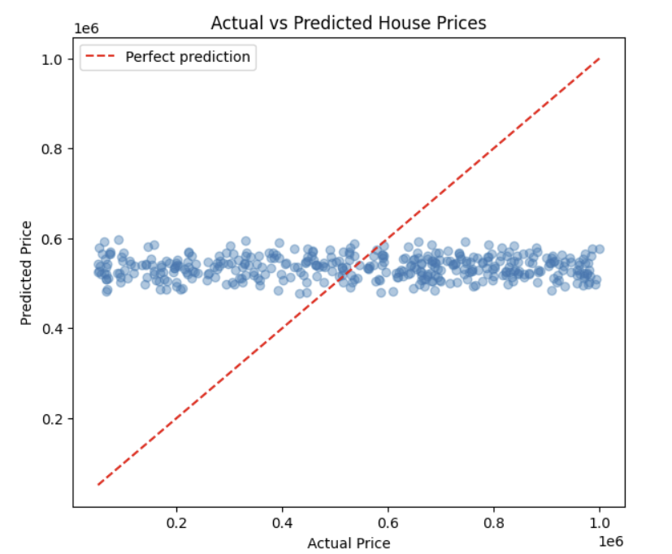

<div align="center">

# 🏠 House Price Prediction

### My first end-to-end Machine Learning project

*I built a model to predict house prices. The data politely informed me it had other plans.* 😄


</div>

---

## 📌 Overview

This project predicts house prices from features such as area, bedrooms, bathrooms, floors, year built, location, condition and garage, using **Linear Regression**.

It covers the full beginner ML workflow: **cleaning → EDA → encoding → train-test split → modelling → evaluation.**

The headline finding is not a high score. It is **why the score was low**: almost none of the features had a meaningful relationship with price. That taught me more than a perfect R² would have.

---

## 🎯 Objectives

- Understand the dataset and verify its quality
- Explore how each feature relates to `Price`
- Encode categorical features correctly (nominal, binary, ordinal)
- Train and evaluate a Linear Regression model
- Diagnose *why* the model performed the way it did

---

## 📂 Dataset

- **Source:** [House Price Prediction Dataset on Kaggle](https://www.kaggle.com/datasets/zafarali27/house-price-prediction-dataset) by zafarali27
- **Target variable:** `Price` (in US dollars)
- **Features:** `Area`, `Bedrooms`, `Bathrooms`, `Floors`, `YearBuilt`, `Location`, `Condition`, `Garage`
- **Dropped:** `Id` (just a row label, no predictive information)

| Feature | Type | Encoding used |
|---|---|---|
| Area, YearBuilt | Numerical | None |
| Bedrooms, Bathrooms, Floors | Numerical (discrete) | None |
| Location | Nominal | One-Hot Encoding |
| Garage | Binary | Mapped to 0 / 1 |
| Condition | Ordinal | Poor=0, Fair=1, Good=2, Excellent=3 |

---

## 🔄 Workflow

```
Raw Data → Cleaning → Univariate EDA → Bivariate EDA → Correlation Analysis
        → Encoding → Train/Test Split (80/20) → Linear Regression → Evaluation
```

### 1. 🧹 Data cleaning
- No duplicate rows and no missing values
- Fixed the data type of `Area`
- Confirmed `Id` is unique, then excluded it from modelling

### 2. 🔍 Univariate analysis
- Histograms, box plots and skewness for numerical columns
- Bar and pie charts for categorical columns
- **Finding:** `Area`, `YearBuilt` and `Price` are nearly symmetric (e.g. `Area` skewness ≈ -0.039), have no outliers, and look roughly **uniform**. Categories are evenly balanced.

### 3. 🔗 Bivariate analysis
- Scatter and regression plots for numeric features vs `Price`
- Group means, box plots and KDE plots for categorical features vs `Price`
- **Finding:** `Area` vs `Price` correlation ≈ **0.0015**, and every categorical group has a similar price distribution with heavy overlap.

### 4. 🔥 Correlation matrix
A heatmap confirmed it: the `Price` row is close to zero everywhere.

### 5. 🤖 Modelling
- 80% training and 20% testing data (`random_state=42`)
- `LinearRegression` from scikit-learn
- `RandomForestRegressor` (200 trees) to test whether a **non-linear** model could find hidden patterns

### 6. 📏 Evaluation
- **R²** as the main metric, compared across all models
- **MAE** and **RMSE** to express error in dollars
- A **mean-price baseline** to show what "no skill" looks like

---

## 📊 Results

| Model | R² | MAE |
|---|---|---|
| Baseline (always predict mean) | -0.0007 | $242,480 |
| Linear Regression | -0.0081 | $243,453 |
| Random Forest | **-0.11** | **$253,910** |

**Takeaway:** Linear Regression performed no better than simply guessing the average price (RMSE ≈ $280K, MAE within about $1,000 of the baseline). Even a more flexible, non-linear model (Random Forest) scored **below the baseline** (about $11K worse MAE), because it overfit noise. This points to the *data*, not the algorithm: the features carry very little predictive signal here.

### 📸 Key visuals

<!-- Save your plots into an "images" folder, then these will display -->

| Correlation Heatmap | Area vs Price |
|---|---|
|  |  |

| Bedrooms vs Price | Actual vs Predicted |
|---|---|
|  |  |

---

## 💡 Key insights

1. **Weak features, weak model.** Features with near-zero correlation to the target can't produce a good model, whatever the algorithm.
2. **The data looks unusual.** Flat distributions and no relationships anywhere suggest the dataset may be **synthetic (randomly generated)**, unlike real housing data where area and location strongly drive price.
3. **EDA predicted the result.** The analysis showed the problem before any model was trained.
4. **A fancier model isn't a better model.** Random Forest (R² ≈ -0.11) did worse than the baseline because it fitted noise.
5. **Model quality = algorithm + data quality.**

---

## 🎓 What I learned

- Handling nominal, binary and ordinal features correctly
- Why the train-test split matters for honest evaluation
- How to interpret R², MAE and RMSE, and why a baseline helps
- What overfitting looks like: a more complex model scoring *worse* than a simple one
- That a low score is a finding, not a failure, if you investigate it

---

## 🚀 Future improvements

- [ ] Try a real-world dataset (Ames Housing or California Housing)
- [ ] Compare against Gradient Boosting (XGBoost / LightGBM)
- [ ] Add feature engineering (house age, price per sq. ft.)
- [ ] Use cross-validation for more reliable scores
- [ ] Hyperparameter tuning of Random Forest

---

## 🛠️ Tech stack

`Python` · `Pandas` · `NumPy` · `Matplotlib` · `Seaborn` · `Scikit-learn`

---

## ▶️ How to run

```bash
# 1. Clone the repository
git clone https://github.com/<your-username>/house-price-prediction.git
cd house-price-prediction

# 2. Install dependencies
pip install pandas numpy matplotlib seaborn scikit-learn jupyter

# 3. Download the dataset from Kaggle (link above) and place the CSV in the project folder

# 4. Update the file path in the notebook's data-loading cell, then launch
jupyter notebook house-price-prediction-polished.ipynb
```

---

## 📁 Repository structure

```
house-price-prediction/
│
├── house-price-prediction-polished.ipynb   # Main notebook
├── README.md                               # Project documentation
└── images/                                 # Saved plots used in this README
```

---

## 🤝 Feedback

This is my **first ML project**, so suggestions are very welcome. If you have ideas on what to try next, please open an issue or reach out!

## 📬 Connect with me

- 💼 LinkedIn: [your-linkedin-url](https://www.linkedin.com/in/your-profile)
- 🐙 GitHub: [your-username](https://github.com/your-username)

---

<div align="center">

⭐ If you found this useful, consider giving the repo a star!

</div>
